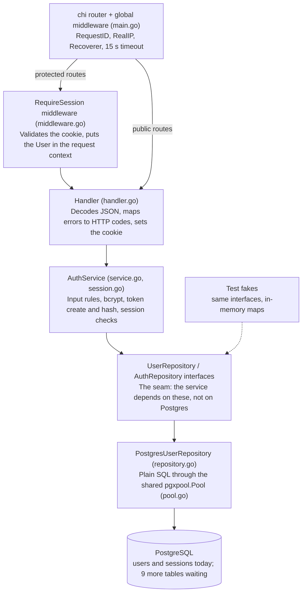
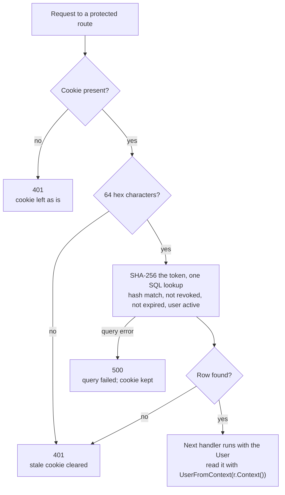
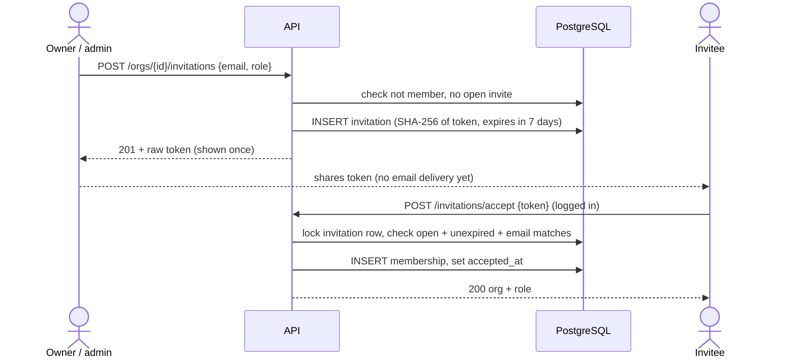

# InsightIQ Backend: Codebase & Request Flow

Last updated: 2026-11-04 · Living version: https://claude.ai/artifact/DBHBjPfE4WNkBYRHzArJUu

## Overview

The InsightIQ backend is a single Go HTTP service in `services/api` that today covers two areas: user accounts with cookie-based sessions, and organizations with memberships and invitations. Other tables in the schema (dashboards, conversations, data sources) exist but have no code yet.

| Concern | Choice |
| --- | --- |
| Language | Go 1.27 |
| HTTP router | `go-chi/chi` v5 |
| Database | PostgreSQL via `jackc/pgx` v5 connection pool |
| Password hashing | bcrypt, cost 12 (`golang.org/x/crypto`) |
| IDs | UUIDs, generated by Postgres (`gen_random_uuid()`) |
| Sessions | Random 32-byte token in an HttpOnly cookie; only its SHA-256 hash is stored |

The code follows a three-layer pattern per feature module: **handler** (HTTP in/out) → **service** (business rules) → **repository** (SQL). Layers talk through Go interfaces, so tests swap the database for in-memory fakes.

## Directory layout

Entry point lives in `cmd/`, feature code in `internal/modules/`, shared infrastructure in `internal/platform/`. Go's `internal/` rule means nothing outside `services/api` can import these packages.

| Path | Role |
| --- | --- |
| `cmd/api/main.go` | Boot: load config, open DB pool, build router, wire modules, start server |
| `cmd/api/main_test.go` | Health endpoint test |
| `internal/platform/database/pool.go` | `NewPool`: builds and pings a `pgxpool.Pool` |
| `internal/modules/auth/model.go` | Request/response structs and the `User`, `Session` types |
| `internal/modules/auth/handler.go` | HTTP handlers: `Register`, `Login`, `Me`, `Logout`; JSON and error helpers |
| `internal/modules/auth/middleware.go` | `RequireSession` middleware, user-in-context helpers, cookie clearing |
| `internal/modules/auth/service.go` | `AuthService`: validation, bcrypt, session creation, validation and logout |
| `internal/modules/auth/session.go` | Token generation, SHA-256 hashing, token format check |
| `internal/modules/auth/repository.go` | `UserRepository` / `AuthRepository` interfaces and their Postgres implementation |
| `internal/modules/organizations/model.go` | Role constants, `Organization`, `Member`, `Invitation` types and request shapes |
| `internal/modules/organizations/handler.go` | `Routes()` sub-router mounted at `/orgs`, accept-invitation handler, error mapping |
| `internal/modules/organizations/service.go` | Permission rules: membership, manager and owner checks; input validation; invitation tokens |
| `internal/modules/organizations/repository.go` | `Repository` interface and Postgres implementation with transactions and row locks |
| `internal/modules/*/*_test.go` | Unit tests with fake repositories |
| `db/migrations/000001_initial_schema.{up,down}.sql` | Full initial schema create and drop |
| `db/migrations/000002_invitations.{up,down}.sql` | `invitations` table |

## Startup and configuration

`main()` refuses to start without `DATABASE_URL`, then builds everything in one straight line. Dependencies are wired by hand; there is no DI framework.

1. `loadConfig()` reads environment variables (table below).
2. A 10-second context bounds startup; `database.NewPool` parses the URL, sets pool limits and pings Postgres. Any failure is fatal.
3. A chi router gets four global middlewares, in order:
   - `RequestID` — tags each request with an ID
   - `RealIP` — trusts `X-Forwarded-For` / `X-Real-IP` for the client IP
   - `Recoverer` — turns a panic into a 500 instead of crashing the process
   - `Timeout(15s)` — cancels the request context after 15 seconds
4. Health routes are registered: `/health/live` (process is up) and `/health/ready` (pings the DB with a 2-second timeout).
5. The auth module is assembled: `PostgresUserRepository` → `AuthService` → `Handler`.
6. Routes are mounted under `/api/v1`; protected ones sit in a `r.Group` that uses `RequireSession`.
7. `http.Server` starts with explicit timeouts so slow clients cannot hold connections forever.

| Variable | Default | Used for |
| --- | --- | --- |
| `APP_PORT` | `8080` | Listen port |
| `DATABASE_URL` | none (required) | Postgres connection string |
| `APP_ENV` | empty | Loaded but not used yet |

| Pool / server setting | Value |
| --- | --- |
| Max / min DB connections | 10 / 2 |
| Max connection lifetime | 1 hour |
| Max connection idle time | 30 minutes |
| `ReadHeaderTimeout` | 5 s |
| `ReadTimeout` | 10 s |
| `WriteTimeout` | 20 s |
| `IdleTimeout` | 60 s |

## Database

Two migrations create 12 tables: `000001_initial_schema` makes 11 and `000002_invitations` adds `invitations`. Code reads and writes `users`, `sessions`, `organizations`, `memberships` and `invitations` today. The schema is multi-tenant: most business tables carry `organization_id`, and composite foreign keys like `(dashboard_id, organization_id)` stop a row from pointing at another tenant's data.

| Table | Purpose | Key columns and constraints | Used by code |
| --- | --- | --- | --- |
| `users` | Accounts | `email` unique, `password_hash`, `status` in (`active`, `suspended`) | Yes |
| `sessions` | Login sessions | `user_id` → users (cascade), `token_hash` unique, `expires_at`, `revoked_at` | Yes |
| `organizations` | Tenants | `slug` unique, `status` | Yes |
| `memberships` | User ↔ org with role | `role` in (`owner`, `admin`, `analyst`, `viewer`); unique per user+org | Yes |
| `invitations` | Pending invites to an org | `token_hash` unique, `email`, `role`, `expires_at`, `accepted_at`, `revoked_at`; one open invite per org+email (partial unique index) | Yes |
| `projects` | Groups dashboards | `organization_id` | No |
| `dashboards` | Dashboard metadata | optional `project_id` in same org, `created_by` | No |
| `widgets` | Dashboard tiles | `type`, `config` JSONB, `position` JSONB | No |
| `data_sources` | External data connections | `type`, `status`, `secret_reference` (pointer, not the secret) | No |
| `conversations` | AI chat threads | must belong to a member of the org | No |
| `messages` | Chat messages | `role` in (`user`, `assistant`, `tool`), `metadata` JSONB | No |
| `audit_logs` | Who did what | `actor_id`, `action`, `resource_type`, `resource_id` | No |

Indexes exist on `sessions(user_id)`, `sessions(expires_at)`, memberships by user and org, widgets by dashboard, messages by conversation and time, and audit logs by org and date. The down migration drops all tables in reverse dependency order.

The pool is a `*pgxpool.Pool` shared by every request. Repositories receive it through their constructor and never open their own connections.

## Auth module architecture

Each request passes down a fixed stack of layers, and each layer knows only the one directly below it.

Public routes skip `RequireSession`; protected routes pass through it first. The interface box is the important seam: in production it is backed by Postgres, in tests by fakes.

- **Handler** owns HTTP only: parsing, status codes, cookies. It never touches SQL or bcrypt.
- **Service** owns the rules: what a valid email is, how passwords are hashed, how long sessions last (7 days). It returns sentinel errors (`ErrInvalidInput`, `ErrEmailAlreadyExists`, `ErrInvalidCredentials`, `ErrInvalidSession`) and the handler maps each to one HTTP status.
- **Repository** owns SQL and translates database errors into those sentinels, for example Postgres error `23505` on `users_email_key` becomes `ErrEmailAlreadyExists`.
- `NewAuthService` takes a `UserRepository` and type-asserts it to `AuthRepository`. `PostgresUserRepository` implements both, so one object serves registration and sessions.

The `organizations` module follows the same three layers. It depends on `auth` only for `auth.User`, `auth.UserFromContext` and the token helpers, and its routes sit inside the same `RequireSession` group.

## Request flows

A user's life cycle is register once, log in to get a cookie, send that cookie on every protected request, and log out to revoke it.

### Register — `POST /api/v1/auth/register`

1. Handler caps the body at 1 MB, decodes JSON strictly (unknown fields and trailing data rejected) → 400 on failure.
2. Service trims the name, trims and lower-cases the email, then checks lengths, email format and password length → 422 on failure.
3. Service bcrypt-hashes the password (cost 12).
4. Repository inserts into `users` and returns the new row; a duplicate email becomes 409.
5. Handler returns 201 with the user. No session is created; the client must log in next.

### Login — `POST /api/v1/auth/login`

1. Handler decodes the JSON body → 400 on failure.
2. Service normalises the email and loads the user plus password hash.
3. Unknown email, suspended user or wrong password all return the same 401 `INVALID_CREDENTIALS`.
4. Service generates 32 random bytes (hex-encoded to 64 characters), stores its SHA-256 hash in `sessions` with `expires_at` = now + 7 days.
5. Handler sets the raw token in the `insightiq_session` cookie and returns the user.

### Session validation — every protected route

Any failed check ends in 401; only a database error returns 500. The first two checks need no database; only a well-formed token costs a query. `GET /api/v1/auth/me` is the simplest protected route: it returns the user that `RequireSession` stored.

### Logout — `POST /api/v1/auth/logout`

1. If a cookie is present and well-formed, the service hashes it and sets `revoked_at = NOW()` on that session.
2. The handler expires the cookie (`Max-Age=-1`) and returns 204.
3. The route is public, so a client with an already-expired session can still clear its cookie.
4. Any later request with the old token fails the lookup and gets 401.

### Organizations and roles

Every organization route first checks membership. A non-member gets 404, never 403, so organization IDs cannot be probed. Roles rank `owner` > `admin` > `analyst` > `viewer`.

| Action | Allowed for |
| --- | --- |
| Create an organization | Any logged-in user; the creator becomes `owner` in the same transaction |
| View organization and members | Any member |
| Invite, list or revoke invitations | `owner`, `admin` |
| Change a member's role, remove a member | `owner`, `admin` |
| Grant `owner`, or change or remove an owner | `owner` only |
| Leave (remove yourself) | Any member |
| Demote or remove the last owner | Nobody — 409 `LAST_OWNER` |

The last-owner rule is enforced in the repository, not the service. Role changes and removals lock the organization row (`SELECT … FOR UPDATE`) first, so two owners demoting each other at the same moment cannot leave the org with zero owners.

### Invite and accept — `POST /orgs/{id}/invitations`, `POST /invitations/accept`

1. An owner or admin sends `email` and `role`. The service lower-cases the email, validates it, and rejects `owner` unless the caller is an owner.
2. The repository returns 409 if that email is already a member or already has an open invite. Expired open invites are revoked first so they do not block a new one.
3. A 32-byte random token is generated; only its SHA-256 hash is stored, with `expires_at` = now + 7 days.
4. The response carries the raw `token` once. There is no email delivery yet, so the inviter passes it on.
5. The invitee logs in and posts the token. In one transaction the invitation row is locked, checked (not accepted, not revoked, not expired, org active), and its email must equal the invitee's account email (else 403 `EMAIL_MISMATCH`).
6. A membership is inserted with the invited role and `accepted_at` is set. A second accept of the same token gets 404.

## API reference

All auth routes live under `/api/v1`; errors always use the shape `{"error": {"code": "...", "message": "..."}}`.

| Method + path | Auth | Request body | Success | Error codes |
| --- | --- | --- | --- | --- |
| `GET /health/live` | None | — | 200 `{"status":"ok"}` | — |
| `GET /health/ready` | None | — | 200 `{"status":"ready"}` | 503 `not_ready` |
| `POST /api/v1/auth/register` | None | `name`, `email`, `password` | 201 `{"data": User}` | 400 `INVALID_REQUEST`, 422 `VALIDATION_ERROR`, 409 `EMAIL_ALREADY_EXISTS`, 500 |
| `POST /api/v1/auth/login` | None | `email`, `password` | 200 `{"data": User}` + `Set-Cookie` | 400 `INVALID_REQUEST`, 401 `INVALID_CREDENTIALS`, 500 |
| `GET /api/v1/auth/me` | Session cookie | — | 200 `{"data": User}` | 401 `UNAUTHENTICATED`, 500 |
| `POST /api/v1/auth/logout` | Cookie optional | — | 204, cookie cleared | 500 |
| `POST /api/v1/orgs` | Session | `name`, `slug` | 201 `{"data": OrgWithRole}` | 422 `VALIDATION_ERROR`, 409 `SLUG_TAKEN` |
| `GET /api/v1/orgs` | Session | — | 200 `{"data": [OrgWithRole]}` | — |
| `GET /api/v1/orgs/{id}` | Member | — | 200 `{"data": OrgWithRole}` | 404 `ORGANIZATION_NOT_FOUND` |
| `GET /api/v1/orgs/{id}/members` | Member | — | 200 `{"data": [Member]}` | 404 `ORGANIZATION_NOT_FOUND` |
| `PATCH /api/v1/orgs/{id}/members/{userId}` | Owner, admin | `role` | 200 `{"data": Member}` | 403 `FORBIDDEN`, 404 `MEMBER_NOT_FOUND`, 409 `LAST_OWNER` |
| `DELETE /api/v1/orgs/{id}/members/{userId}` | Owner, admin, or self | — | 204 | 403 `FORBIDDEN`, 404 `MEMBER_NOT_FOUND`, 409 `LAST_OWNER`, 409 `MEMBER_HAS_DATA` |
| `POST /api/v1/orgs/{id}/invitations` | Owner, admin | `email`, `role` | 201 `{"data": Invitation + token}` | 403 `FORBIDDEN`, 409 `ALREADY_MEMBER`, 409 `INVITATION_EXISTS` |
| `GET /api/v1/orgs/{id}/invitations` | Owner, admin | — | 200 `{"data": [Invitation]}` | 403 `FORBIDDEN` |
| `DELETE /api/v1/orgs/{id}/invitations/{invId}` | Owner, admin | — | 204 | 404 `INVITATION_NOT_FOUND` |
| `POST /api/v1/invitations/accept` | Session, invited email | `token` | 200 `{"data": OrgWithRole}` | 404 `INVITATION_NOT_FOUND`, 403 `EMAIL_MISMATCH`, 409 `ALREADY_MEMBER` |

All organization routes also return 401 `UNAUTHENTICATED` without a session and 400 `INVALID_REQUEST` for malformed JSON. A malformed ID in the path returns the matching 404.

Shapes: `OrgWithRole` is `{id, name, slug, status, created_at, role}`; `Member` is `{user_id, name, email, role, joined_at}`; `Invitation` is `{id, organization_id, email, role, invited_by, expires_at, created_at}`. Slugs are 3–100 characters of lowercase letters, digits and single hyphens.

A `User` is `{id, name, email, status, created_at}`. The password hash never leaves the repository layer.

The session cookie is `insightiq_session`: `HttpOnly`, `SameSite=Lax`, `Path=/`, 7-day `Max-Age`, `Secure=false` (development only).

Register rules: name 1–150 characters after trimming; email lower-cased, trimmed, at most 320 characters and must parse as a bare address; password 12–72 bytes (72 is bcrypt's input limit). Unknown JSON fields and trailing JSON are rejected; the body is capped at 1 MB.

## Testing

All tests are unit tests and need no database; run them with `go test ./...` from `services/api`. As of this writing they pass with `go vet` clean.

| File | What it covers |
| --- | --- |
| `cmd/api/main_test.go` | `/health/live` returns 200 with `application/json` |
| `auth/service_test.go` | Register trims and lower-cases input, bcrypt-hashes the password, rejects short passwords, passes through duplicate-email errors |
| `auth/session_test.go` | Tokens are 64 hex characters and unique; hashing is deterministic and differs from the token |
| `auth/handler_test.go` | `RequireSession`: valid session passes and puts the user in context; missing, unknown and malformed cookies get 401 and a cleared cookie; repository failure gets 500. Logout revokes by hash and the session is rejected afterwards |
| `organizations/service_test.go` | Creator becomes owner; slug validation; non-members see not found; viewers cannot invite; admins cannot grant, demote or remove owners; last owner cannot leave or be demoted; members can leave but not remove others; full invite → accept flow incl. email mismatch and single use; duplicate, already-member and revoked invitations |
| `organizations/handler_test.go` | Create then get over HTTP; 401, 404 for bad and unknown IDs, 400 for unknown fields, 422 for invalid slug |

Fakes: `fakeUserRepository` implements `UserRepository`; `fakeAuthRepository` embeds it and adds the `AuthRepository` methods with an in-memory map of hash → user. `NewAuthService` detects the extra methods with a type assertion, so the same constructor works for real and fake repositories.

Not covered yet: both Postgres repositories (need an integration test database), the `Login` handler end to end, and `Register` handler request parsing. The organizations fake mirrors the last-owner and duplicate rules, but the real row locking is only provable against Postgres.

## Security notes and known gaps

The session design is sound — random tokens, hashed at rest, server-side revocation — but several items must be fixed before production.

What is already in place:

- Passwords: bcrypt cost 12; 72-byte cap matches bcrypt's real input limit.
- Sessions: only SHA-256 hashes are stored, so a database leak yields no usable cookies.
- Login does not reveal whether an email exists: unknown email, wrong password and suspended account all return the same `INVALID_CREDENTIALS`.
- Session checks run in SQL against the DB clock and re-check user status on every request, so suspending a user cuts off live sessions at once.
- Cookies are `HttpOnly` (no JavaScript access) and `SameSite=Lax` (basic CSRF protection for cross-site POSTs).

Gaps to close:

- [ ] Set cookie `Secure: true` outside development, driven by `APP_ENV`
- [ ] Add `http.MaxBytesReader` and the trailing-JSON check to `Login`, matching `Register`
- [ ] Rate-limit `/auth/login`, `/auth/register` and invitation creation
- [ ] Add a job that deletes expired and revoked rows from `sessions` and `invitations`
- [ ] Add a migration runner; both migrations are applied by hand today
- [ ] Fix the local run guide: it exports `PORT` but the code reads `APP_PORT`, and it points to `services/api/migrations/001_init.sql` instead of `db/migrations/`
- [ ] Integration tests for the Postgres repositories, especially the organization locks
- [ ] Send invitation emails; today the raw token is returned to the inviter once
- [ ] Decide what happens to a removed member's conversations; the foreign key has no cascade, so removal returns 409 `MEMBER_HAS_DATA`
- [ ] Use organization roles in future routes (dashboards, data sources); `RequireSession` proves identity, the organizations service proves membership
